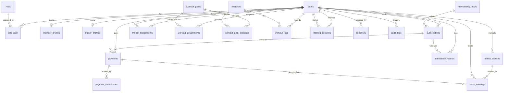

# GymCore — TIGAT GYM Management System (Version 1)

Welcome to the engineering documentation for **GymCore**, an enterprise-grade gym management platform designed specifically for the premier fitness brand **TIGAT GYM**.

---

## 1. Project Overview & Architectural Scope

- **Project Name:** GymCore
- **Brand:** TIGAT GYM
- **Version:** Version 1.0 (Single-Gym Architecture)
- **Target OS:** Windows
- **Development Environment:** Google Antigravity IDE
- **Frontend Stack:** React 19 + Vite 8
- **Backend Stack:** Laravel 13 (RESTful API) + Laravel Sanctum
- **Database Engine:** MySQL 8.0.46 (InnoDB storage engine, `utf8mb4_unicode_ci`)
- **Primary Currency:** Ethiopian Birr (`ETB`)

### Architectural Scope Decision (Version 1 vs. Future Version 2)
- **Version 1 Scope:** Strictly supports **one gym location: TIGAT GYM**.
- **No Multi-Branch Clutter:** Version 1 intentionally avoids adding premature `branch_id` columns, `branches` tables, or multi-tenant SaaS overhead.
- **Future Version 2 Strategy:** The database uses strictly normalized integer foreign keys (`users.id`, `subscriptions.id`, etc.) and decoupled domain tables. Version 2 will introduce multi-location support safely by adding a `branches` table and executing a non-breaking backfill migration (documented in [Section 9](#9-version-2-multi-branch-migration-strategy)).

---

## 2. Software Requirements & Verified Versions

| Component | Minimum Required | Verified Host Version | Status |
| :--- | :--- | :--- | :--- |
| **Operating System** | Windows 10 / 11 | Windows 11 (PowerShell 5.1/7) | Verified |
| **PHP** | `^8.3` | **PHP 8.3.31 (cli)** | Verified |
| **Composer** | `^2.2` | **Composer 2.10.3** | Verified |
| **Node.js** | `^20.0` | **v24.19.0** | Verified |
| **npm** | `^10.0` | **11.17.0** | Verified |
| **MySQL Database** | MySQL 8.0+ | **MySQL 8.0.46 (InnoDB)** | Verified |
| **Laravel Framework**| Laravel 13+ | **v13.39.0** | Verified |
| **Laravel Sanctum** | `^4.0` | **v4.3.3** | Verified |
| **React + Vite** | React 19, Vite 8 | **React 19.3.1, Vite 8.3.5** | Verified |

---

## 3. Environment Setup & Configuration

The project is structured into two main sub-directories:
- `backend/`: Laravel API application
- `frontend/`: React + Vite single-page application

### Step 3.1: Backend Environment Setup
1. Open PowerShell and navigate to the backend directory:
   ```powershell
   cd backend
   ```
2. Verify dependencies:
   ```powershell
   composer install
   ```
3. Generate application encryption key (if not already set):
   ```powershell
   php artisan key:generate
   ```
4. Verify MySQL service is active on `127.0.0.1:3306` with database `TigatGym`.
5. Configure `backend/.env` (using `backend/.env.example` as a baseline):
   ```env
   APP_NAME=GymCore
   APP_ENV=local
   APP_KEY=base64:...
   APP_DEBUG=true
   APP_URL=http://localhost:8000
   FRONTEND_URL=http://localhost:5173
   SANCTUM_STATEFUL_DOMAINS=localhost:5173,127.0.0.1:5173

   DB_CONNECTION=mysql
   DB_HOST=127.0.0.1
   DB_PORT=3306
   DB_DATABASE=TigatGym
   DB_USERNAME=root
   DB_PASSWORD=your_mysql_password
   ```

### Step 3.2: Frontend Environment Setup
1. Navigate to the frontend directory:
   ```powershell
   cd ../frontend
   ```
2. Install frontend dependencies:
   ```powershell
   npm install
   ```
3. Configure `frontend/.env` (using `frontend/.env.example` as a baseline):
   ```env
   VITE_APP_NAME="GymCore"
   VITE_GYM_NAME="TIGAT GYM"
   VITE_API_BASE_URL=http://localhost:8000/api
   ```

### Step 3.3: Running the Applications Locally
- **Backend API Server:**
  ```powershell
  cd backend
  php artisan serve --port=8000
  ```
- **Frontend Vite Dev Server:**
  ```powershell
  cd frontend
  npm run dev
  ```
- Access the frontend dashboard at `http://localhost:5173` and backend API health status at `http://localhost:8000/api/status`.

---

## 4. Environment Variables Reference

### Backend (`backend/.env`)
| Variable | Default Value | Purpose |
| :--- | :--- | :--- |
| `APP_NAME` | `GymCore` | Application identifier |
| `APP_ENV` | `local` | Environment mode (`local`, `production`) |
| `APP_URL` | `http://localhost:8000` | Backend API base URL |
| `FRONTEND_URL` | `http://localhost:5173` | Allowed CORS origin for Vite frontend |
| `SANCTUM_STATEFUL_DOMAINS` | `localhost:5173,127.0.0.1:5173` | Allowed SPA domains for Sanctum session/cookie auth |
| `DB_CONNECTION` | `mysql` | Database driver |
| `DB_HOST` | `127.0.0.1` | MySQL server host |
| `DB_PORT` | `3306` | MySQL server port |
| `DB_DATABASE` | `TigatGym` | GymCore MySQL database |
| `DB_USERNAME` | `root` | MySQL user |
| `DB_PASSWORD` | *(User password)* | MySQL root password (never committed to git) |

### Frontend (`frontend/.env`)
| Variable | Default Value | Purpose |
| :--- | :--- | :--- |
| `VITE_APP_NAME` | `GymCore` | Frontend branding name |
| `VITE_GYM_NAME` | `TIGAT GYM` | Display gym brand |
| `VITE_API_BASE_URL` | `http://localhost:8000/api` | API endpoint used by `apiClient` service |

---

## 5. Complete Database Architecture (32 Tables)

The database consists of **23 application domain tables** and **8 Laravel framework tables**, all configured on **InnoDB** with strict referential integrity, indexes, unique constraints, and soft-delete protections.

### Domain 1: User Accounts & Role-Based Authorization
1. **`users`**: Central account identity for owners, admins, staff, trainers, and gym members.
   - *Columns:* `id`, `name`, `email` (unique), `phone` (index), `status` (active/inactive/suspended), `avatar`, `email_verified_at`, `password`, `remember_token`, timestamps, `deleted_at`.
2. **`roles`**: Authorization roles (`owner`, `admin`, `receptionist`, `trainer`, `member`).
   - *Columns:* `id`, `name` (unique), `display_name`, `description`, `is_system`, timestamps.
3. **`role_user`**: Pivot table mapping users to roles (supports multi-role staff when needed).
   - *Columns:* `id`, `user_id` (FK cascade), `role_id` (FK cascade), timestamps.
   - *Constraints:* `UNIQUE(user_id, role_id)`.

### Domain 2: Member & Trainer Profiles
4. **`member_profiles`**: Extended demographic, emergency contact, and QR access details for members.
   - *Columns:* `id`, `user_id` (FK cascade, unique), `member_code` (unique), `qr_code_token` (unique), `date_of_birth`, `gender`, `blood_type`, `address`, `emergency_contact_name`, `emergency_contact_phone`, `emergency_contact_relationship`, `health_conditions`, `fitness_goals`, `joined_at`, timestamps, `deleted_at`.
5. **`trainer_profiles`**: Staff credentials, coaching specializations, and commission rates.
   - *Columns:* `id`, `user_id` (FK cascade, unique), `trainer_code` (unique), `specialization`, `bio`, `certifications`, `hourly_rate` (DECIMAL), `commission_rate` (DECIMAL), `is_available`, `joined_at`, timestamps, `deleted_at`.
6. **`trainer_assignments`**: Member-to-trainer coaching assignments.
   - *Columns:* `id`, `member_id` (FK users, restrict), `trainer_id` (FK users, restrict), `assigned_by` (FK users, nullOnDelete), `status` (active/paused/completed/cancelled), `start_date`, `end_date`, `notes`, timestamps.
   - *Indexes:* `INDEX(member_id, trainer_id, status)`.

### Domain 3: Membership Management & Subscriptions
7. **`membership_plans`**: Membership packages (Day pass, Monthly, VIP, etc.).
   - *Columns:* `id`, `name`, `slug` (unique), `description`, `price` (DECIMAL 12,2), `currency` (default `'ETB'`), `duration_type` (day/week/month/year), `duration_value`, `access_hours_type` (all_day/off_peak/morning/evening), `has_trainer_access`, `has_class_access`, `max_class_bookings`, `is_active`, timestamps, `deleted_at`.
8. **`subscriptions`**: Member subscription contract history and renewal lifecycle.
   - *Columns:* `id`, `member_id` (FK users, restrict), `membership_plan_id` (FK membership_plans, restrict), `subscription_number` (unique), `start_date`, `end_date`, `status` (pending/active/expired/cancelled/frozen), `cancellation_reason`, `cancelled_at`, `frozen_until`, `price`, `discount`, `total_amount` (DECIMAL 12,2), `currency`, `is_auto_renew`, `notes`, `created_by` (FK users, nullOnDelete), timestamps, `deleted_at`.
   - *Indexes:* `INDEX(member_id, status)`, `INDEX(end_date, status)`.

### Domain 4: Payments & Financial Accounting
9. **`payments`**: Master ledger recording payments made by members or visitors.
   - *Columns:* `id`, `payment_number` (unique), `user_id` (FK users, restrict), `payable_type`, `payable_id` (polymorphic relationship to `Subscription`, `ClassBooking`, etc.), `amount` (DECIMAL 12,2), `currency` (`'ETB'`), `payment_method` (cash/bank_transfer/chapa/pos/other), `payment_type` (subscription/class_fee/trainer_fee/product/registration/other), `status` (pending/completed/failed/refunded/partially_refunded), `paid_at`, `recorded_by` (FK users, nullOnDelete), `receipt_number` (unique), `notes`, timestamps, `deleted_at`.
   - *Indexes:* `INDEX(user_id, status)`, `INDEX(paid_at)`.
10. **`payment_transactions`**: Low-level audit trail for payment attempts, bank slips, and Chapa gateway webhooks.
    - *Columns:* `id`, `payment_id` (FK payments, restrict), `transaction_reference` (unique), `gateway` (manual/chapa/bank_slip/cbe_birr/telebirr/other), `gateway_reference` (index), `amount` (DECIMAL 12,2), `currency`, `status` (initiated/pending/successful/failed/refunded), `idempotency_key` (unique for webhook replay protection), `bank_name`, `bank_account_number`, `proof_attachment_path`, `gateway_response` (JSON), `ip_address`, `verified_at`, timestamps.
11. **`expenses`**: Operational expenditures (rent, utilities, equipment purchase, maintenance, payroll).
    - *Columns:* `id`, `expense_number` (unique), `category` (rent/utilities/equipment/maintenance/salary/marketing/cleaning/supplies/tax/other), `title`, `description`, `amount` (DECIMAL 12,2), `currency`, `payment_method`, `expense_date`, `recipient`, `receipt_attachment_path`, `recorded_by` (FK users, restrict), `approved_by` (FK users, nullOnDelete), `status` (pending/approved/rejected/paid), timestamps, `deleted_at`.

### Domain 5: Attendance Tracking
12. **`attendance_records`**: QR code check-in and reception entry logs.
    - *Columns:* `id`, `member_id` (FK users, restrict), `subscription_id` (FK subscriptions, nullOnDelete), `check_in_time`, `check_out_time`, `method` (qr_code/manual_reception/member_code/rfid), `status` (admitted/denied/flagged), `denial_reason`, `qr_payload_hash` (tamper verification), `verified_by` (FK users, nullOnDelete), `notes`, timestamps.
    - *Indexes:* `INDEX(member_id, check_in_time)`, `INDEX(status)`.

### Domain 6: Workout Management & Personal Coaching
13. **`exercises`**: Exercise movements directory and video instructions library.
    - *Columns:* `id`, `name` (unique), `slug` (unique), `category` (strength/cardio/hypertrophy/etc.), `muscle_group` (chest/back/legs/etc.), `equipment_needed`, `difficulty`, `instructions`, `video_url`, `image_path`, `is_active`, timestamps, `deleted_at`.
14. **`workout_plans`**: Structured fitness routines and training templates.
    - *Columns:* `id`, `title`, `slug` (unique), `description`, `goal`, `difficulty_level`, `duration_weeks`, `days_per_week`, `created_by` (FK users, nullOnDelete), `is_template`, `is_active`, timestamps, `deleted_at`.
15. **`workout_plan_exercises`**: Prescription details for each exercise in a workout plan.
    - *Columns:* `id`, `workout_plan_id` (FK workout_plans, cascade), `exercise_id` (FK exercises, restrict), `day_number`, `order_in_day`, `sets`, `reps_min`, `reps_max`, `rest_seconds`, `target_weight` (DECIMAL 6,2), `notes`, timestamps.
16. **`workout_assignments`**: Assignment of workout plans to gym members.
    - *Columns:* `id`, `workout_plan_id` (FK workout_plans, restrict), `member_id` (FK users, cascade), `trainer_id` (FK users, nullOnDelete), `start_date`, `end_date`, `status` (active/completed/paused/abandoned), `custom_notes`, timestamps.
17. **`workout_logs`**: Member performance tracking logs (sets, reps, weights lifted).
    - *Columns:* `id`, `member_id` (FK users, cascade), `workout_assignment_id` (FK workout_assignments, nullOnDelete), `exercise_id` (FK exercises, restrict), `logged_date`, `set_number`, `reps_completed`, `weight_used` (DECIMAL 6,2), `weight_unit` (default `'kg'`), `rpe` (Rate of Perceived Exertion), `notes`, timestamps.
18. **`training_sessions`**: 1-on-1 personal training appointments between members and coaches.
    - *Columns:* `id`, `session_code` (unique), `trainer_id` (FK users, restrict), `member_id` (FK users, cascade), `scheduled_start`, `scheduled_end`, `status` (scheduled/in_progress/completed/cancelled_by_member/cancelled_by_trainer/no_show), `cancellation_reason`, `focus_area`, `trainer_feedback`, `member_rating` (1-5), `member_review`, timestamps.

### Domain 7: Fitness Classes & Bookings
19. **`fitness_classes`**: Group exercise schedule (Spinning, Aerobics, Boxing, Yoga, CrossFit).
    - *Columns:* `id`, `name`, `slug` (unique), `description`, `trainer_id` (FK users, restrict), `room`, `capacity` (default 20), `start_time`, `end_time`, `recurrence` (none/daily/weekly/biweekly), `status` (scheduled/ongoing/completed/cancelled), `cancellation_reason`, `price` (DECIMAL 10,2), `currency`, timestamps, `deleted_at`.
20. **`class_bookings`**: Member reservations for scheduled classes.
    - *Columns:* `id`, `fitness_class_id` (FK fitness_classes, cascade), `member_id` (FK users, cascade), `payment_id` (FK payments, nullOnDelete), `status` (reserved/attended/cancelled/no_show), `booking_time`, `cancelled_at`, `cancellation_reason`, timestamps.
    - *Constraints:* `UNIQUE(fitness_class_id, member_id)` (Anti-duplicate booking guarantee).

### Domain 8: Equipment Inventory & System Notifications
21. **`notifications`**: Framework-integrated database notifications table.
    - *Columns:* `id` (UUID primary key), `type`, `notifiable_type`, `notifiable_id`, `data` (JSON/text), `read_at`, timestamps.
22. **`equipment`**: Gym machine and weights inventory, condition, and maintenance intervals.
    - *Columns:* `id`, `equipment_code` (unique), `name`, `category`, `brand`, `model_number`, `serial_number`, `purchase_date`, `purchase_cost` (DECIMAL 12,2), `currency`, `status` (operational/needs_maintenance/under_repair/out_of_service/decommissioned), `location_area`, `last_inspected_at`, `next_maintenance_due`, `maintenance_notes`, timestamps, `deleted_at`.

### Domain 9: Security & Administrative Auditing
23. **`audit_logs`**: Administrative and financial audit trail.
    - *Columns:* `id`, `user_id` (FK users, nullOnDelete), `action`, `auditable_type`, `auditable_id` (polymorphic), `old_values` (JSON, sanitized to exclude secrets), `new_values` (JSON, sanitized to exclude secrets), `ip_address`, `user_agent`, `notes`, `created_at`.

### Framework Tables (8 Tables)
- **`migrations`**: Internal Laravel migration history.
- **`password_reset_tokens`**: Temporary tokens for user password reset workflows.
- **`sessions`**: Database-driven session storage.
- **`cache` & `cache_locks`**: High-performance database caching and atomic locks.
- **`jobs` & `job_batches` & `failed_jobs`**: Asynchronous task queues and job failure auditing.
- **`personal_access_tokens`**: Laravel Sanctum API authentication tokens.

---

## 6. Entity Relationship Diagram (Mermaid)



---

## 7. Database Verification Results

All 21 migrations were executed against MySQL 8.0.46 database `TigatGym`:

```text
Database: TigatGym
Storage Engine: InnoDB (100% of tables)
Default Collation: utf8mb4_unicode_ci
Total Tables: 32 (23 Application Tables + 8 Framework Tables + 1 Migrations Table)
Seeded Roles: 5 (owner, admin, receptionist, trainer, member)
Referential Integrity: Foreign keys with explicit RESTRICT, CASCADE, or SET NULL
```

### Table Inventory Verification
```text
+------------------------------------+--------+--------------------+-------+
| Table Name                         | Engine | Collation          | Rows  |
+------------------------------------+--------+--------------------+-------+
| attendance_records                 | InnoDB | utf8mb4_unicode_ci | 0     |
| audit_logs                         | InnoDB | utf8mb4_unicode_ci | 0     |
| cache                              | InnoDB | utf8mb4_unicode_ci | 0     |
| cache_locks                        | InnoDB | utf8mb4_unicode_ci | 0     |
| class_bookings                     | InnoDB | utf8mb4_unicode_ci | 0     |
| equipment                          | InnoDB | utf8mb4_unicode_ci | 0     |
| exercises                          | InnoDB | utf8mb4_unicode_ci | 0     |
| expenses                           | InnoDB | utf8mb4_unicode_ci | 0     |
| failed_jobs                        | InnoDB | utf8mb4_unicode_ci | 0     |
| fitness_classes                    | InnoDB | utf8mb4_unicode_ci | 0     |
| job_batches                        | InnoDB | utf8mb4_unicode_ci | 0     |
| jobs                               | InnoDB | utf8mb4_unicode_ci | 0     |
| member_profiles                    | InnoDB | utf8mb4_unicode_ci | 0     |
| membership_plans                   | InnoDB | utf8mb4_unicode_ci | 0     |
| migrations                         | InnoDB | utf8mb4_unicode_ci | 21    |
| notifications                      | InnoDB | utf8mb4_unicode_ci | 0     |
| password_reset_tokens              | InnoDB | utf8mb4_unicode_ci | 0     |
| payment_transactions               | InnoDB | utf8mb4_unicode_ci | 0     |
| payments                           | InnoDB | utf8mb4_unicode_ci | 0     |
| personal_access_tokens             | InnoDB | utf8mb4_unicode_ci | 0     |
| role_user                          | InnoDB | utf8mb4_unicode_ci | 0     |
| roles                              | InnoDB | utf8mb4_unicode_ci | 5     |
| sessions                           | InnoDB | utf8mb4_unicode_ci | 0     |
| subscriptions                      | InnoDB | utf8mb4_unicode_ci | 0     |
| trainer_assignments                | InnoDB | utf8mb4_unicode_ci | 0     |
| trainer_profiles                   | InnoDB | utf8mb4_unicode_ci | 0     |
| training_sessions                  | InnoDB | utf8mb4_unicode_ci | 0     |
| users                              | InnoDB | utf8mb4_unicode_ci | 0     |
| workout_assignments                | InnoDB | utf8mb4_unicode_ci | 0     |
| workout_logs                       | InnoDB | utf8mb4_unicode_ci | 0     |
| workout_plan_exercises             | InnoDB | utf8mb4_unicode_ci | 0     |
| workout_plans                      | InnoDB | utf8mb4_unicode_ci | 0     |
+------------------------------------+--------+--------------------+-------+
```

---

## 8. Security & Engineering Rules

1. **No Destructive Database Commands in Production/Dev:**
   - Never run `php artisan migrate:fresh`, `db:wipe`, or `DROP DATABASE`. Always use forward migrations.
2. **Financial Precision:**
   - All financial amounts use `DECIMAL(12, 2)` or `DECIMAL(10, 2)`. Floating-point types (`FLOAT`, `DOUBLE`) are strictly forbidden for currency.
3. **Restrictive Financial Deletions:**
   - Payments and subscriptions cannot be cascade-deleted (`restrictOnDelete()`) to protect historical accounting integrity and compliance.
4. **Online Payment Verification Rule:**
   - A frontend browser redirect must **never** be accepted as payment proof. Payments must be verified via server-to-server webhook / verification requests, checked against `idempotency_key` and `transaction_reference`.
5. **Subscription Business Rule:**
   - Recording a payment does not automatically activate a subscription unless business rules validate:
     - Full payment received (`amount >= total_amount`)
     - Subscription status is currently `pending` or eligible for renewal
     - Valid start and end dates are generated
6. **Sanctum & CORS Security:**
   - Allowed origins are locked to `FRONTEND_URL` (`http://localhost:5173`).
   - `supports_credentials => true` enables secure HTTP-only cookies or Bearer token auth.
7. **Audit Log Privacy:**
   - Passwords, access tokens, and payment secrets are strictly excluded from `audit_logs.old_values` and `audit_logs.new_values`.

---

## 9. Version 2 Multi-Branch Migration Strategy

Version 1 is purposefully built for **TIGAT GYM** as a single gym. When TIGAT GYM expands into multiple branches in Version 2, the transition can be executed seamlessly without refactoring or breaking existing V1 data:

### Safe 3-Step V2 Transition Plan:
1. **Step 1: Create `branches` Table**
   - Migration creates `branches` (`id`, `name`, `code`, `city`, `address`, `phone`, `is_active`, timestamps).
2. **Step 2: Seed the Original Gym as Branch #1**
   - Insert `TIGAT GYM — Main Branch` (Code: `TG-MAIN`, ID: `1`).
3. **Step 3: Add Nullable `branch_id` Foreign Keys & Backfill**
   - Add `branch_id` to `member_profiles`, `subscriptions`, `attendance_records`, `payments`, `expenses`, `equipment`, `fitness_classes`.
   - Execute an atomic SQL update backfilling existing records:
     ```sql
     UPDATE member_profiles SET branch_id = 1 WHERE branch_id IS NULL;
     UPDATE subscriptions SET branch_id = 1 WHERE branch_id IS NULL;
     UPDATE attendance_records SET branch_id = 1 WHERE branch_id IS NULL;
     UPDATE payments SET branch_id = 1 WHERE branch_id IS NULL;
     UPDATE expenses SET branch_id = 1 WHERE branch_id IS NULL;
     UPDATE equipment SET branch_id = 1 WHERE branch_id IS NULL;
     UPDATE fitness_classes SET branch_id = 1 WHERE branch_id IS NULL;
     ```
   - Change `branch_id` column constraints to `NOT NULL` with foreign key references to `branches(id)`.
4. **Result:**
   - Zero downtime, zero data corruption, and 100% backward compatibility.

---

## 10. Development Roadmap & Next Modules

The database foundation is complete. In subsequent phases, each application module will be implemented:

1. **Module 1: Authentication & RBAC API** (Sanctum login, registration, role checks, password reset)
2. **Module 2: Member Registration & Management** (Member profiles, photo upload, emergency contacts)
3. **Module 3: Membership Plans & Subscriptions** (Plan creation, subscription issuance, freeze/cancel)
4. **Module 4: Payments & Chapa Gateway** (Cash receipts, bank transfer slips, Chapa integration)
5. **Module 5: QR Code Attendance System** (QR generation, camera scanner, admission rules)
6. **Module 6: Trainer Portal & Assignments** (Trainer roster, member assignments, coach notes)
7. **Module 7: Workout Library & Routines** (Exercise bank, workout plan builder, member workout log)
8. **Module 8: 1-on-1 Personal Training Sessions** (Booking calendar, feedback, session completion)
9. **Module 9: Fitness Classes & Reservations** (Class schedules, anti-duplicate booking, attendance)
10. **Module 10: Equipment & Maintenance** (Asset registry, maintenance alerts, service history)
11. **Module 11: Financial & Membership Reporting** (Revenue reports, active subscriptions, churn)
12. **Module 12: Notification Engine** (In-app notifications, email notifications, SMS readiness)
13. **Module 13: Audit Trail & Administrative Dashboard** (Activity logs, security monitors)
